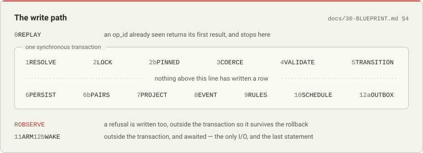

<picture>
  <source media="(prefers-color-scheme: dark)" srcset=".github/media/banner-dark.svg">
  
</picture>

# Give your business a memory.

Everything a company knows that isn't code — what it is owed, what renews on Tuesday, which key
opens what, who decided the thing nobody can remember deciding — lives in somebody's head, six
spreadsheets and a Slack thread. This is one database for all of it: typed, append-only, and yours.

Your agents get a key to it. Claude, Codex and Cursor read and write the same rows you do, over
MCP, and every row remembers who put it there and when. Nothing is edited in place, so nothing is
quietly lost — you can always ask what it said last Tuesday, and it can tell you.

One SQLite file. Open source, AGPL-3.0. Self-host it, or don't.

```
git clone https://github.com/actuallyhoss/braindog
cd braindog
pnpm install
pnpm test
```

Node 24 or newer, and pnpm. `BUILD.md` has the rest.

---

## Status

**Being built in the open, and not finished.** The kernel works and the browser client is complete
against a synthetic record; the wiring between them is the current job. `REPORT.md` is the honest
running account — what is built, what is left, and the defects found this week. Read that before
depending on any of this.

Today: 1,308 tests, 19 gates, 54 specification documents in `docs/`.

## What makes it different from a folder of markdown

**It is typed.** Money has an amount, a currency and a date. Quantities have units. Domains have
renewal dates. So "what is due in October" is a question with an answer, rather than a search.

**Every agent sees the same rows.** Over MCP, with the same permissions you have. No vendor is going
to build you the screen that shows what you pay its competitors.

**Decisions are rows.** An agent lays out the options and never picks one. You pick, and it becomes
a numbered row with a reason attached that nothing can quietly edit later.

**The history cannot be rewritten, including by you.** There is one write path and the log is
append-only by construction. Of four comparable products surveyed, three ship a mutable history —
one has a *Clear revision history* button whose result "cannot be retrieved". See
[docs/20-COLLABORATION.md](docs/20-COLLABORATION.md) §9.

## Your data

| | |
|---|---|
| **`.dog`** | one SQLite file per record. `sqlite3 portfolio.dog "select …"` works with no library and no permission |
| **`.dogl`** | the same content as a canonical dump, one JSON row per line, signed |
| **a pack** | registers, pages, metrics and rules as readable text — a way of working you can share, with no code in it |

Export is never withheld, on any plan, in any state. That is the point of the file formats being
boring.

## Extending it

**Extensions are data. Where data is not enough, the extension is an agent — never a script.**

A pack declares registers, pages, metrics and rules. It contains no code, so there is no sandbox to
secure and every extension is a file you can read and diff. The worst a bad pack achieves is a
misleading page, plus — if it declares a connector — one scheduled GET to a host named in the diff.
You see both before anything is applied.

## Architecture

One kernel, three runtimes. The record is a SQLite Durable Object per customer on Cloudflare, or one
Node process over `node:sqlite` if you run it yourself, from the same packages. The frontend is a
static SvelteKit app that talks to either.

Everything is reachable three ways from one route table so they cannot drift: HTTP, an MCP server,
and a typed client.

<picture>
  <source media="(prefers-color-scheme: dark)" srcset=".github/media/write-path-dark.svg">
  
</picture>

Every write takes that path, and the event is appended in the same transaction as the row it
describes — which is what "append-only by construction" means here. There is no hash chain and there
are no triggers; there is one writer, and the history is a table nothing deletes from.
[docs/30-BLUEPRINT.md](docs/30-BLUEPRINT.md) §4 specifies each step, and `REPORT.md` says which of
them are built.

## Repository

| | |
|---|---|
| `docs/` | 54 numbered specification documents. The source of truth — nothing is designed twice |
| `packages/kernel` | the write path, the ledger, types, filters, metrics, rules, the vault index |
| `packages/render` | the block dialect and the renderer (MIT, published separately) |
| `packages/theme` | solves a whole palette from one seed against contrast floors |
| `apps/web` | the record's own interface |
| `apps/site` | the marketing site |
| `apps/worker` | the Cloudflare host |
| `apps/selfhost` | the Node host |
| `tools/gates` | 21 gates, each tested against a seeded violation — 28 of them |

## Running it

`alpha.brain.dog` is the deployment this repository builds on every push to `master` — the same
Worker and the same frontend, wearing a different accent and a word so nobody confuses the two
windows. [DEPLOYMENT.md](DEPLOYMENT.md) records every build setting it runs under, including the one
environment variable the whole deployment identity hangs on, because otherwise that lives in a
dashboard and a dashboard is not reviewable.

## Contributing

`CONTRIBUTING.md` covers the build, the tests, the gates, and the house style — which is unusual and
worth reading before your first pull request. `SECURITY.md` is how to report a vulnerability.

## Licence

AGPL-3.0-only, except `packages/render`, which is MIT so that the block dialect can be used
anywhere. `LICENSING.md` explains the split.
