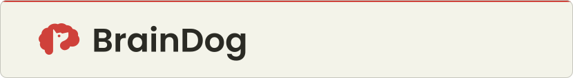
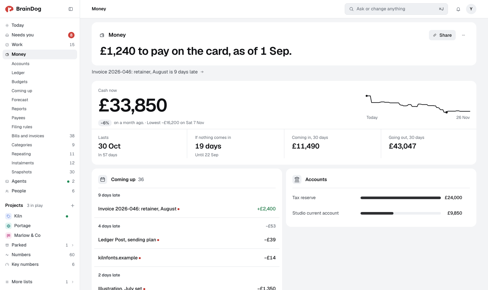

<picture>
  <source media="(prefers-color-scheme: dark)" srcset=".github/media/banner-dark.svg">
  
</picture>

# Your agents keep track. You make the calls.

One place for your projects, decisions and money. Every agent reads it before it starts and writes down what it did.
Money, keys and deletes wait for your yes.

BrainDog is open source. Use it hosted at [brain.dog](https://brain.dog), or run it on your own machine.

[Website](https://brain.dog) · [Docs](https://brain.dog/docs) · [Connect your agents](#connect-your-agents) ·
[Run it yourself](#run-it-yourself) · [Plugins](#plugins-and-starters)

<picture>
  <source media="(prefers-color-scheme: dark)" srcset=".github/media/screenshot-dark.png">
  
</picture>

<sub>Today on the sample record. Every name and figure in it is made up.</sub>

## What it does

- **Work.** Projects and tasks. Each project shows where it stands and the next step.
- **Agents.** Each agent you connect starts by reading where the project stands and writes the next step down when it
  ends. Every agent signs in with your yes and puts its name on what it writes. You see who is working on what.
- **Needs you.** Questions from agents wait in one list, each with what would happen and why. Your answer is kept,
  with its reason.
- **Money.** Accounts, bills, invoices, budgets and how long the cash lasts, in more than one currency. Import a bank
  statement as a CSV and each line is filed.
- **People.** Clients, contacts, and who owes whom. Import them from a CSV or a vCard.
- **Keys.** Keep API keys in the record. Agents use them without ever seeing them.
- **Attachments.** Put PDFs, pictures, documents and HTML pages on a project or a task. Agents read them.
- **Team.** Invite people with one of five roles: Owner, Can decide, Can edit, Can add or Can view. Their agents get
  the same access, no more. Share one page with a read-only link, with or without money.
- **Slash.** Press ⌘J (Ctrl J on Windows) and ask BrainDog in plain words. It answers from your own numbers, and a
  change it makes comes with an undo.
- **Plugins.** Everything else, from bank feeds to a landlord's rent book. See [Plugins](#plugins-and-starters).

It works in any browser. The iPhone app is in testing on TestFlight, and a Mac app is built from the same project.
Neither is in the App Store yet.

## What always holds

- Every change has a name on it and an undo.
- History is never rewritten. You can ask what the record said last Tuesday.
- Money, keys, sharing and deletes wait for your yes. You can let your own agents skip that, but reading a key,
  giving the record away and deleting it stay yours.
- You can export everything as one file at any time.

## Connect your agents

**By address.** Any client that takes an MCP server address can use this one:

```text
https://app.brain.dog/mcp
```

In Claude that is Settings, Connectors, Add custom connector. The first time, the client opens BrainDog in your
browser. Pick the record and what the agent may do, then press Allow.

**With the command line.** For Claude Code and other agents on your machine. It needs Node 24.13 or later.

```sh
curl -fsSL https://brain.dog/cli/install.sh | sh     # macOS and Linux
irm https://brain.dog/cli/install.ps1 | iex          # Windows, in PowerShell
braindog setup https://app.brain.dog/<your record>
```

`setup` signs the machine in (you approve six digits in the app), adds the Claude Code hooks, registers the MCP
server and places the [Agent Skill](skills/braindog/SKILL.md). [apps/cli/README.md](apps/cli/README.md) has the
rest, and [brain.dog/docs/agents/connect](https://brain.dog/docs/agents/connect) covers every client.

**As a Claude Code plugin.** This adds the MCP server, the session hooks and the skill in one step:

```text
/plugin marketplace add actuallyhoss/BrainDog
/plugin install braindog@braindog
```

## Attachments

Put a file on a project, a task or any row.

- A PDF opens in the browser's own viewer.
- An HTML page, such as an artifact an agent made, is drawn in a sandbox. It can load its chart and style libraries,
  and it can't reach the app, your sign-in or anything else.
- Agents read every file as text.
- A file can be up to 25 MB. Every add, rename and removal is in the history, with who and when.

From the command line:

```sh
braindog attach brief.pdf dashboard.html --to "Fix the login"
braindog attach --list --to "Fix the login"
```

## Plugins and starters

Projects, Work, People and Agents are built in. Everything else is a plugin, installed from the app's Plugins page:
Money and its parts (investments, property, insurance, debts, goals, trips, zakat), Stripe, Mercury, Gmail, Calendar,
Sentry, standups, project briefs and more. A starter is a set of plugins and example rows for one kind of work, such as
a photographer, a landlord or a retainer business.

**Where they come from.**

- **The plugin store.** Nothing from outside is listed until a person at BrainDog has reviewed it.
- **Any GitHub repo.** The install is pinned to a commit, and updates come from that repo.
- **Your own BrainDog.** Ask an agent for something BrainDog doesn't do. It writes the plugin, checks it, and asks
  you before it installs.

**What they can do.** Lists, pages, figures and rules. Tools your agents can call, commands, and actions on a row.
Views they draw themselves. Scripts that notify you, ask a model or keep their own data. You see each of these before
you install, and a plugin gets only what you approved. Scripts run in a sandbox and reach only the hosts the file
names.

**If one goes wrong.** BrainDog can switch off a bad version of a store plugin wherever it is installed, and tells you
why. Its rows stay.

**Make one.** A plugin is one readable file, so you can read and diff it before it is applied. The command line
still calls it `addon`.

```sh
braindog addon new plant-care                    # a folder with the file, a test and a README
braindog addon dev plant-care                    # a scratch BrainDog that installs each save
braindog addon check plant-care
braindog addon publish plant-care --github       # or --kennel, to send it to the store for review
```

The bundled ones live in [`packs/`](packs/) (the folder keeps its old name), and [packs/README.md](packs/README.md)
shows how to write one.

## Two ways to run it

**Hosted, at [app.brain.dog](https://app.brain.dog).** Each record is its own database on Cloudflare. Keys are
sealed, and a sealed copy is made every night. Sign-up is by invitation for now: ask for one at
[brain.dog](https://brain.dog).

**Run it yourself.** Free. One container, one volume, no account with us.

### Run it yourself

```sh
git clone https://github.com/actuallyhoss/BrainDog braindog
cd braindog
cp selfhost.env.example .env      # set BRAINDOG_OWNER (your email) and BRAINDOG_SERVER_KEY (the server key)
docker compose up -d --build
docker compose logs braindog      # once started, it ends with the address
docker compose exec braindog cat /data/claim-link      # a one-time link: open it and add a passkey
```

Without Docker you need Node 24.13 or later and pnpm. This serves `http://localhost:8080` to your own machine, where
nobody signs in:

```sh
pnpm install
pnpm --filter @braindog/web build
export BRAINDOG_DATA=$HOME/braindog-data
node apps/selfhost/src/main.ts init <record name> --owner <your email>
node apps/selfhost/src/main.ts
```

Mail, a model for Slash and a public address are optional and off until you set them.
[apps/selfhost/README.md](apps/selfhost/README.md) covers connecting agents, backups, restores and upgrades.
[docs/49-SPEC-SELFHOST.md](docs/49-SPEC-SELFHOST.md) lists every setting the server reads.

## How it's built

TypeScript throughout, on Node 24, with no build step for most packages.

- `packages/kernel` is the write path: one way in, an append-only ledger, types, filters, figures and rules.
- `packages/record` puts the kernel, the declarations and plugins together into one record over SQLite.
- `packages/mcp` serves the record to agents.
- `packages/script` is the sandbox plugin scripts run in.
- `packages/render` is the block dialect and its renderers, published on its own as `braindog-render`.
- `apps/web` is the app, in SvelteKit. Both hosts serve the same build.
- `apps/worker` is the hosted version on Cloudflare Workers: one Durable Object, with its own SQLite, per record.
  It also runs the plugin store.
- `apps/selfhost` is the same record on one Node process over `node:sqlite`, and the container.
- `apps/cli` is the `braindog` command line, and `apps/site` is brain.dog.
- `apps/apple` is the iPhone and Mac app. `apps/desktop` is the older desktop shell, kept for Windows and Linux.
- `tools/gates` holds the source checks every change passes.

The design is written down first, in [`docs/`](docs/). [docs/00-README.md](docs/00-README.md) is the index, and
[docs/01-ARCHITECTURE.md](docs/01-ARCHITECTURE.md) is the place to start.

## Docs

- [brain.dog/docs](https://brain.dog/docs): using BrainDog, connecting agents, the HTTP API and writing plugins.
- [`docs/`](docs/): the numbered design and specification documents.
- [DEPLOYMENT.md](DEPLOYMENT.md): how the hosted version is deployed.

## Security

Please don't open a public issue for a vulnerability. [SECURITY.md](SECURITY.md) says how to report one privately.
[docs/12-SECURITY.md](docs/12-SECURITY.md) is the security model in full.

## Contributing

Issues and pull requests are welcome. Read [CONTRIBUTING.md](CONTRIBUTING.md) first. It covers the build, the tests,
the gates and the house style, and a pull request that skips it is usually sent back. Everyone here follows the
[code of conduct](CODE_OF_CONDUCT.md).

## Licence

BrainDog is open source under the Apache License 2.0 ([LICENSE](LICENSE)). The exception is `packages/render`, under
the MIT License ([packages/render/LICENSE](packages/render/LICENSE)), so the block dialect can be embedded anywhere.
[LICENSING.md](LICENSING.md) explains the split.

The software is provided as is, without warranty of any kind, express or implied. See the licence texts for the full
terms.
